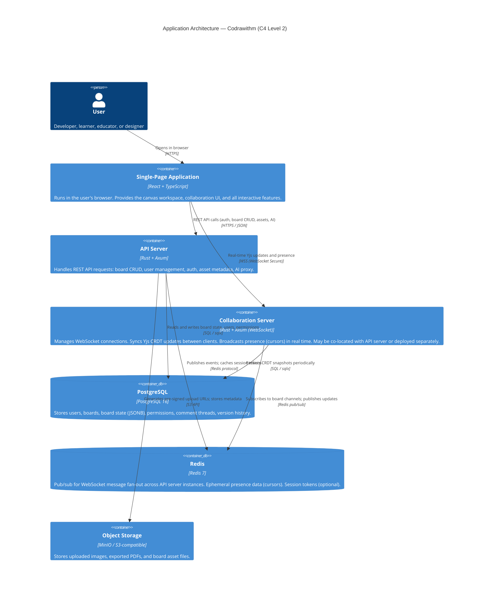

# Application Architecture (C4 Level 2)

**Status:** Proposed  
**Last Updated:** 2024-01-15

---

## Overview

The C4 Level 2 diagram zooms into the Codrawithm system and shows its major containers (deployable units or runtime processes).

---

## Container Diagram



---

## Container Descriptions

### Single-Page Application (SPA)

**Technology:** React 18 + TypeScript, built with Vite.  
**Deployed as:** Static files (HTML, JS, CSS, assets) served by Caddy or a CDN.

**Responsibilities:**
- Renders the canvas using Konva.js.
- Manages client-side state via Zustand stores.
- Communicates with the REST API via TanStack Query.
- Manages the Yjs document and syncs via y-websocket.
- Handles plugin iframe loading and postMessage communication.
- Renders the 3D workspace via React Three Fiber.

**Key internal modules:**
- `canvas/` — Canvas engine, tools, hit testing.
- `collaboration/` — Yjs setup, awareness, sync hooks.
- `stores/` — Zustand canvas, auth, UI stores.
- `features/` — Algorithm visualization, AI Studio, 3D workspace.
- `plugins/` — Plugin loader, sandbox, postMessage bridge.
- `ui/` — shadcn/ui components, design system.

See [Frontend Architecture](frontend-architecture.md) for module details.

---

### API Server

**Technology:** Rust + Axum.  
**Deployed as:** Docker container.

**Responsibilities:**
- Authentication: JWT issuance, refresh token rotation, OAuth 2.0 exchange.
- Board CRUD: Create, read, update, delete boards; permission checking.
- Asset management: Validate uploads; generate pre-signed S3 URLs.
- AI proxy: Accept AI requests from the SPA; add API key (from env); forward to provider; return response.
- Plugin registry: Store and serve plugin manifests.
- REST API documented via OpenAPI (generated with utoipa).

**Key routes:**
```
POST   /auth/login
POST   /auth/refresh
POST   /auth/logout
GET    /users/me
GET    /boards
POST   /boards
GET    /boards/:id
PATCH  /boards/:id
DELETE /boards/:id
POST   /boards/:id/assets/upload-url
POST   /ai/generate
GET    /plugins
GET    /health
GET    /ready
```

---

### Collaboration Server

**Technology:** Rust + Axum, WebSocket upgrade.  
**Deployed as:** Same Docker container as the API server (Phase 1). Can be extracted to a separate service if scale demands (Phase 3+).

**Responsibilities:**
- Upgrade HTTP connections to WebSocket for Yjs sync.
- Receive binary Yjs update messages from clients.
- Broadcast updates to all other clients on the same board via Redis pub/sub.
- Persist CRDT state to PostgreSQL on a configurable interval (default: every 5 seconds) and on connection close.
- Handle Yjs awareness protocol for presence (cursor positions, user info).

**WebSocket message types:**
```rust
enum WsMessage {
    SyncStep1(Vec<u8>),     // Yjs sync step 1 (initial state vector)
    SyncStep2(Vec<u8>),     // Yjs sync step 2 (full state)
    Update(Vec<u8>),        // Yjs incremental update
    Awareness(Vec<u8>),     // Yjs awareness (presence) update
    Ping,                   // Heartbeat
    Pong,
}
```

---

### PostgreSQL

**Key tables:**
- `users` — User accounts, OAuth identities.
- `boards` — Board metadata, workspace type, settings.
- `board_state` — JSONB column for current board content (Yjs state).
- `board_snapshots` — Versioned history snapshots.
- `board_members` — User-board permission assignments.
- `comments` — Comment threads and replies.
- `assets` — Uploaded asset metadata (S3 key, MIME type, size).

See [Database Design](database-design.md) for full schema.

---

### Redis

**Usage:**
- **Pub/sub:** The collaboration server publishes Yjs updates to a per-board Redis channel. All collaboration server instances subscribed to that channel receive and forward updates to their connected clients. This enables horizontal scaling.
- **Presence:** Cursor positions and user awareness data stored with short TTL (3 seconds).
- **Session cache:** (Optional) JWT refresh token allowlist.

---

### Object Storage

**Usage:**
- Uploaded images and assets from the canvas.
- Generated PDF exports (stored temporarily for download).
- Board thumbnail images (generated server-side on save).

**Access model:** The SPA never uploads directly to S3. The API server generates a pre-signed upload URL with a 15-minute expiry. The browser uploads directly to the pre-signed URL. The API server then validates and registers the asset after upload confirmation.

---

## Deployment Topology (Phase 1)

For Phase 1 (self-hosted, small scale), all components run as Docker Compose services on a single host:

```
Docker Host
├── spa (Caddy serving static files)
├── api (API + Collaboration server, single Rust binary)
├── postgres
├── redis
└── minio (object storage)
```

See [Deployment Architecture](deployment-architecture.md) for the full Docker Compose configuration.

---

## Related Documents

- [Architecture Overview](overview.md)
- [System Context](system-context.md)
- [Frontend Architecture](frontend-architecture.md)
- [Backend Architecture](backend-architecture.md)
- [Database Design](database-design.md)
- [Deployment Architecture](deployment-architecture.md)
