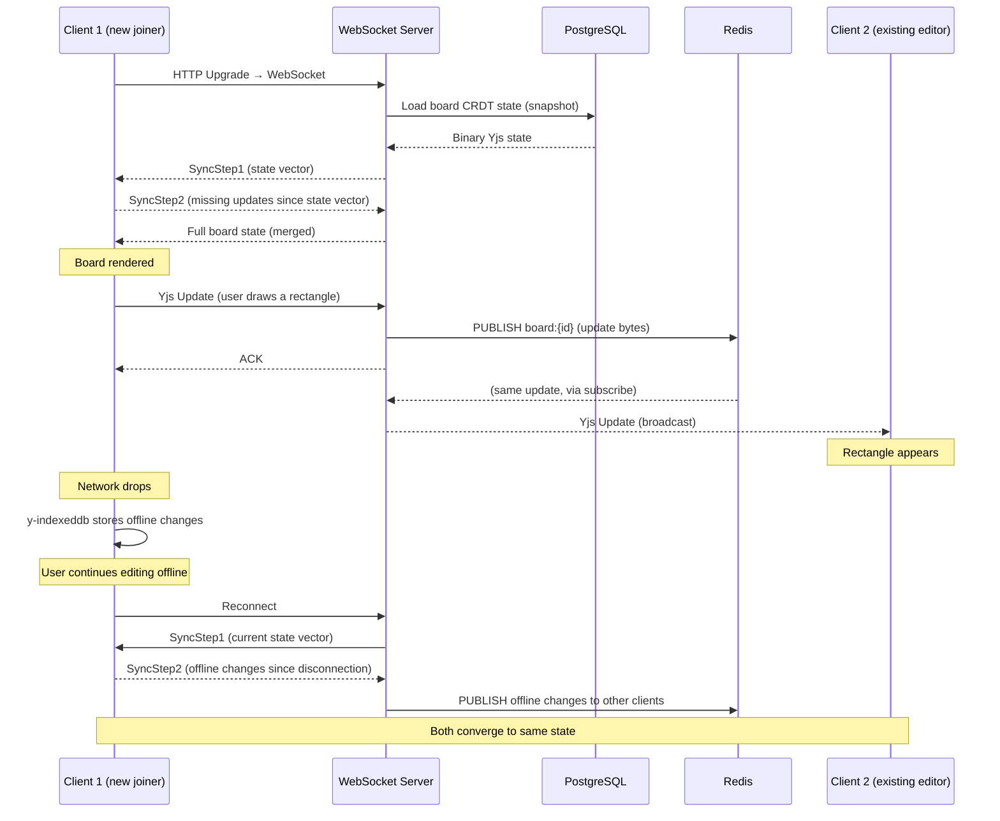

# Collaboration Engine

**Status:** Proposed  
**Last Updated:** 2024-01-15

---

## Overview

The collaboration engine enables real-time concurrent editing of canvas boards by multiple users. It is built on **Yjs CRDTs** for conflict-free editing and a **WebSocket transport** for real-time message delivery.

See [ADR-008](architecture-decisions/ADR-008-real-time-collaboration.md) for the decision record.

---

## Architecture Summary

```
Client A ──┐
           ├──► WebSocket Server ──► Redis Pub/Sub ──► WebSocket Server ──► Client B
Client C ──┘
```

1. Each client maintains a **local Yjs document** (`Y.Doc`) — a CRDT that tracks the full canvas state.
2. When a user edits the canvas, Yjs generates a **binary update**.
3. The update is sent to the backend via WebSocket.
4. The backend publishes the update to a **Redis channel** for this board.
5. All other backend instances subscribed to that channel broadcast the update to their connected clients.
6. Each client's Yjs document applies the update — converging to the same state.

---

## Yjs Document Structure

```typescript
const ydoc = new Y.Doc();

// Main canvas objects (replicated)
const yObjects = ydoc.getArray<Y.Map<unknown>>('objects');

// Connectors (replicated)
const yConnectors = ydoc.getArray<Y.Map<unknown>>('connectors');

// Frames (replicated)
const yFrames = ydoc.getArray<Y.Map<unknown>>('frames');

// Algorithm state (replicated)
const yAlgorithm = ydoc.getMap<unknown>('algorithm');

// 3D scene objects (replicated)
const yThreeDObjects = ydoc.getArray<Y.Map<unknown>>('threeDObjects');

// Board metadata (replicated)
const yMeta = ydoc.getMap<unknown>('meta');

// Awareness (ephemeral, not persisted)
// Provided by the WebSocket provider
provider.awareness;
```

Each object in `yObjects` is a `Y.Map` — a CRDT map. Individual fields (x, y, width, height, fill, etc.) are updated independently, enabling fine-grained conflict resolution.

---

## Sync Protocol Sequence Diagram



---

## Transport: y-websocket Protocol

The WebSocket transport follows the [y-websocket protocol](https://github.com/yjs/y-websocket#protocol):

| Message Type | Binary Prefix | Description |
|-------------|--------------|-------------|
| `messageSync` | `0` | Yjs sync messages (SyncStep1, SyncStep2, Update) |
| `messageAwareness` | `1` | Awareness updates (cursor positions, user info) |
| `messageQueryAwareness` | `3` | Request all current awareness states |

Messages are encoded as binary (`Uint8Array`) for efficiency.

---

## Ephemeral vs. Durable State

| State Type | Storage | Examples |
|-----------|---------|---------|
| **Durable** | PostgreSQL (CRDT snapshot) | Shape positions, text, colors, connectors |
| **Durable** | PostgreSQL (awareness-derived) | Comment threads, board metadata |
| **Ephemeral** | Redis (TTL: 3 seconds) | Cursor positions, user presence |
| **Ephemeral** | In-memory (not persisted) | Laser pointer position, temp drag preview |

Durable state is persisted by the backend in two ways:
1. **Periodic snapshots:** Every 5 seconds, the backend writes the current CRDT state to PostgreSQL.
2. **On disconnect:** When all clients disconnect from a board, a final snapshot is written.

---

## Awareness Protocol (Presence)

The Yjs awareness protocol is used for ephemeral presence data:

```typescript
// Client sets its awareness state
provider.awareness.setLocalStateField('cursor', {
  x: worldX,
  y: worldY,
  viewportX: screenX,
  viewportY: screenY,
});

provider.awareness.setLocalStateField('user', {
  id: currentUser.id,
  name: currentUser.displayName,
  color: currentUser.cursorColor,
  avatarUrl: currentUser.avatarUrl,
});

// Client receives other users' awareness
provider.awareness.on('change', ({ added, updated, removed }) => {
  const states = provider.awareness.getStates();
  // Re-render remote cursors
});
```

Awareness updates are broadcast via the WebSocket server and stored in Redis with a 3-second TTL. Clients that don't send an update for 3 seconds are considered disconnected.

---

## Conflict Resolution

Yjs uses a CRDT merge algorithm (inspired by LSEQ and RGA). The key merge semantics:

| Operation | Merge Behavior |
|-----------|---------------|
| Set field (x, y, fill, etc.) | Last-write-wins per field |
| Insert into array | Concurrent insertions are both preserved; ordering may differ from either client's intent |
| Delete from array | Delete wins over concurrent insert at the same position |
| Concurrent text edits | Character-level CRDT merging (RGA) |

**Practical result:** In the common case (users editing different objects), merges are transparent. For rare concurrent edits of the same object field (two users simultaneously moving the same shape), the shape ends up at the last position — no data is lost.

---

## Horizontal Scaling

The backend can scale horizontally because all cross-instance coordination uses Redis:

```
Load Balancer
    │
    ├─► Backend Instance 1 (Client A, Client B)
    │         │
    │     Redis Pub/Sub ←──────────── Redis Pub/Sub
    │         │                              │
    └─► Backend Instance 2 (Client C)  ─────┘
```

When Client A (on instance 1) sends an update, instance 1 publishes it to Redis. Instance 2, subscribed to the same board channel, receives it and forwards it to Client C.

---

## Related Documents

- [Sync Protocol](../collaboration/sync-protocol.md)
- [Conflict Resolution](../collaboration/conflict-resolution.md)
- [Presence & Cursors](../collaboration/presence-and-cursors.md)
- [Offline Mode](../collaboration/offline-mode.md)
- [ADR-008: Real-Time Collaboration](architecture-decisions/ADR-008-real-time-collaboration.md)
