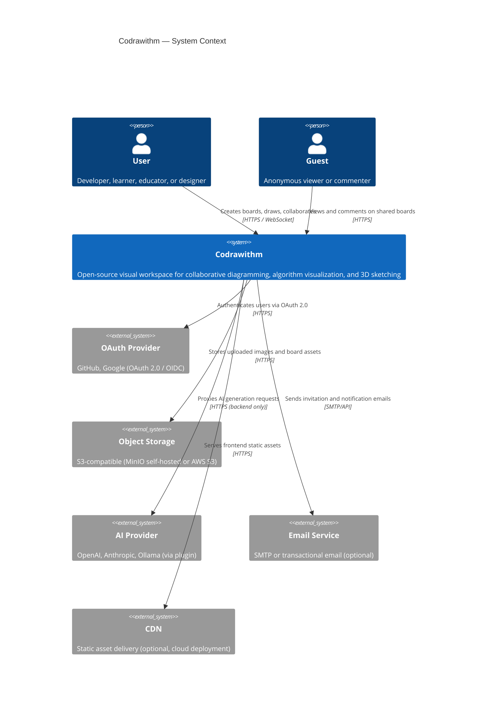
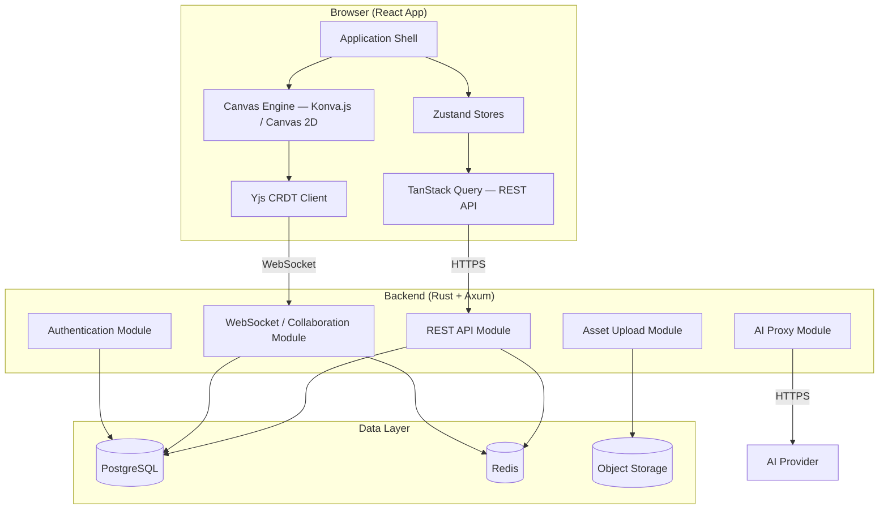

# Architecture Overview

**Status:** Proposed  
**Last Updated:** 2024-01-15

---

## Summary

Codrawithm is a browser-first collaborative visual workspace. The architecture is designed around three core constraints:

1. **Real-time collaboration at low latency** — multiple editors, one canvas, no conflicts.
2. **High-performance canvas rendering** — thousands of objects, 60 fps.
3. **Open-source, self-hostable** — no vendor lock-in; simple deployment.

The system is structured as a **React + TypeScript frontend** communicating with a **Rust + Axum modular monolith backend**, using **Yjs CRDTs** for real-time sync, **PostgreSQL** for persistence, and **Redis** for ephemeral state and pub/sub.

---

## System Context Diagram

---

## High-Level Component Overview

---

## Key Architectural Decisions

| Decision | Choice | ADR |
|---------|--------|-----|
| Architecture style | Web-first, no native app | [ADR-001](architecture-decisions/ADR-001-web-first-architecture.md) |
| Backend structure | Modular monolith (not microservices) | [ADR-002](architecture-decisions/ADR-002-modular-monolith.md) |
| Frontend framework | React + TypeScript | [ADR-003](architecture-decisions/ADR-003-frontend-framework.md) |
| Canvas rendering | Canvas 2D (Konva.js) + WebGL for large scenes | [ADR-004](architecture-decisions/ADR-004-canvas-rendering-approach.md) |
| Scene document model | Flat object array with CRDT backing | [ADR-005](architecture-decisions/ADR-005-scene-document-model.md) |
| 3D rendering | React Three Fiber + Three.js | [ADR-006](architecture-decisions/ADR-006-3d-rendering-framework.md) |
| State management | Zustand + TanStack Query | [ADR-007](architecture-decisions/ADR-007-state-management.md) |
| Real-time collaboration | Yjs CRDT over WebSocket | [ADR-008](architecture-decisions/ADR-008-real-time-collaboration.md) |
| Backend language | Rust + Axum | [ADR-009](architecture-decisions/ADR-009-backend-language-framework.md) |
| Database | PostgreSQL + Redis + S3-compatible | [ADR-010](architecture-decisions/ADR-010-database-and-storage.md) |
| AI integration | Backend-proxied, no browser secrets | [ADR-011](architecture-decisions/ADR-011-ai-provider-integration.md) |
| Plugin sandboxing | iframe + postMessage | [ADR-012](architecture-decisions/ADR-012-plugin-sandboxing.md) |
| Authentication | JWT + refresh tokens, RBAC | [ADR-013](architecture-decisions/ADR-013-authentication-approach.md) |
| Open-source license | To be decided (AGPL-3.0 vs Apache-2.0) | [ADR-014](architecture-decisions/ADR-014-open-source-license.md) |

---

## Design Constraints

### Constraint 1: No Paid External Services Required

The system must be fully functional without any paid cloud services. All external services (storage, email, AI) must have self-hosted alternatives:
- Object storage → MinIO (S3-compatible).
- Email → any SMTP server.
- AI provider → Ollama (local LLM).

### Constraint 2: Horizontal Scalability

The backend must not store per-connection state in memory. All state (board data, presence) flows through Redis. This enables horizontal scaling of the backend by simply adding more instances behind a load balancer.

### Constraint 3: Graceful Degradation

If the WebSocket server is unavailable, the canvas must still be usable in a read-only degraded mode. Users see a banner and cannot edit, but the board content is visible from the last loaded state.

### Constraint 4: Plugin Isolation

Plugins must not be able to access the host page DOM, read user data, or make arbitrary network requests. All plugin execution is sandboxed in iframes with a strict CSP.

---

## Data Flow Summary

### Canvas Edit Flow (Happy Path)

1. User draws a shape on the canvas.
2. Canvas engine creates a new shape object.
3. Yjs CRDT applies the operation locally (optimistic update — instant visual feedback).
4. Yjs serializes the operation as a binary update.
5. WebSocket transport sends the update to the backend.
6. Backend broadcasts the update to all other connected clients.
7. Backend persists the update to PostgreSQL.
8. Other clients receive the update and apply it to their local CRDT.
9. Other clients' canvas engines re-render the new shape.

### Read-Only View Flow

1. User opens a read-only share link.
2. Frontend loads the board JSON from the REST API.
3. Canvas engine renders the board state.
4. WebSocket connection is not established (read-only).
5. User cannot edit but can scroll, zoom, and comment.

---

## Further Reading

- [System Context (C4 Level 1)](system-context.md)
- [Application Architecture (C4 Level 2)](application-architecture.md)
- [Frontend Architecture](frontend-architecture.md)
- [Backend Architecture](backend-architecture.md)
- [Collaboration Engine](collaboration-engine.md)
- [Architecture Decisions](architecture-decisions/README.md)
