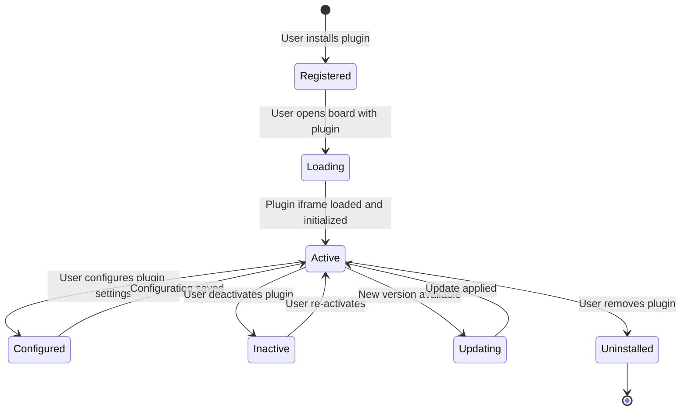

# Plugin System Architecture

**Status:** Proposed  
**Last Updated:** 2024-01-15

---

## Overview

The plugin system allows third-party developers to extend Codrawithm with new tools, AI providers, shape libraries, and workspace types. Plugins run in isolated sandboxes and communicate with the host canvas via a controlled API.

See [ADR-012](architecture-decisions/ADR-012-plugin-sandboxing.md) and the [Plugin documentation](../plugins/) for user-facing details.

---

## Sandboxing Architecture

Plugins run inside `<iframe>` elements with a restrictive sandbox attribute:

```html
<iframe
  src="https://plugin-origin.example.com/plugin.html"
  sandbox="allow-scripts allow-forms allow-popups"
  csp="default-src 'self'; script-src 'self' 'unsafe-inline';"
  allow="none"
/>
```

**What the `sandbox` attribute prevents:**
- `allow-same-origin` is NOT included — the iframe cannot access the parent page's DOM or cookies.
- `allow-top-navigation` is NOT included — the plugin cannot redirect the parent page.
- `allow-storage-access-by-user-activation` is NOT included — no access to localStorage or sessionStorage.

**Communication:** The plugin communicates with the host via `window.postMessage()`. The host validates the message origin against the plugin's registered URL before processing.

---

## Plugin Manifest

Every plugin declares its metadata and requirements in a `plugin.json` manifest:

```json
{
  "id": "com.example.text-to-flowchart",
  "name": "Text to Flowchart",
  "version": "1.0.0",
  "description": "Generate flowcharts from natural language descriptions using AI",
  "author": "Example Corp",
  "homepage": "https://example.com/plugin",
  "entrypoint": "https://example.com/plugin/index.html",
  "permissions": [
    "canvas:read",
    "canvas:write",
    "ai:generate",
    "network:https:api.example.com"
  ],
  "categories": ["ai", "flowchart"],
  "icon": "https://example.com/plugin/icon.png",
  "minHostVersion": "0.5.0"
}
```

See [Plugin Manifest](../plugins/plugin-manifest.md) for the full schema.

---

## Permission Model

Plugins declare permissions in the manifest. Users are shown a consent dialog when installing a plugin. The host only sends messages to the plugin that are covered by the granted permissions.

| Permission | Description |
|-----------|-------------|
| `canvas:read` | Read canvas object data |
| `canvas:write` | Create, update, delete canvas objects |
| `canvas:select` | Read current selection |
| `ai:generate` | Invoke the AI generation API (via backend proxy) |
| `board:metadata` | Read board title, workspace type, settings |
| `user:identity` | Read the current user's display name and ID (no email) |
| `network:https:{domain}` | Make outbound HTTPS requests to a specific domain |
| `clipboard:write` | Write to the clipboard |
| `notifications` | Show in-app notifications |

**Not grantable:**
- Access to other users' data.
- Access to authentication tokens or cookies.
- Access to other boards.
- Network requests to arbitrary domains (must specify each domain).

---

## Host API (postMessage Bridge)

The host exposes a typed API to plugins via postMessage. All messages are JSON objects with a `type` field.

**Plugin → Host:**

```typescript
// Request canvas objects
parent.postMessage({ type: 'canvas:getObjects' }, '*');

// Create a rectangle
parent.postMessage({
  type: 'canvas:createObject',
  payload: { type: 'rectangle', x: 100, y: 100, width: 200, height: 100, label: 'My Box' }
}, '*');

// Request AI generation
parent.postMessage({
  type: 'ai:generate',
  payload: { prompt: 'A login flow with success and error paths', mode: 'flowchart' }
}, '*');
```

**Host → Plugin:**

```typescript
// Response to canvas:getObjects
window.postMessage({ type: 'canvas:objects', payload: [...objects] }, pluginOrigin);

// AI generation result
window.postMessage({ type: 'ai:result', payload: { objects: [...] } }, pluginOrigin);

// Canvas selection changed
window.postMessage({ type: 'canvas:selectionChanged', payload: { selectedIds: [...] } }, pluginOrigin);
```

See [Plugin API](../plugins/plugin-api.md) for the complete message protocol.

---

## Plugin Lifecycle



---

## Plugin Registry

The backend maintains a plugin registry:

```
GET  /plugins                 → List all installed plugins for the current workspace
GET  /plugins/:id             → Get plugin manifest
POST /plugins/install          → Install a plugin (validates manifest, stores)
DELETE /plugins/:id            → Uninstall a plugin
```

For self-hosted deployments, admins can restrict which plugins are allowed.

---

## Security Considerations

- Plugin iframes are cross-origin — they cannot access the host DOM or cookies.
- `postMessage` origin is validated on every message — the host rejects messages from unexpected origins.
- Network requests from plugins to external domains require explicit `network:https:{domain}` permission and are enforced by CSP headers.
- Plugin manifests are fetched and cached by the backend — the frontend never fetches untrusted manifest URLs directly.
- Permissions are checked on every API call — the host checks the plugin's granted permissions before processing a message.

See [Plugin Security](../plugins/plugin-security.md) for the full security model.

---

## Related Documents

- [Plugin Manifest](../plugins/plugin-manifest.md)
- [Plugin API](../plugins/plugin-api.md)
- [Plugin Permissions](../plugins/plugin-permissions.md)
- [Plugin Lifecycle](../plugins/plugin-lifecycle.md)
- [Plugin Security](../plugins/plugin-security.md)
- [ADR-012: Plugin Sandboxing](architecture-decisions/ADR-012-plugin-sandboxing.md)
