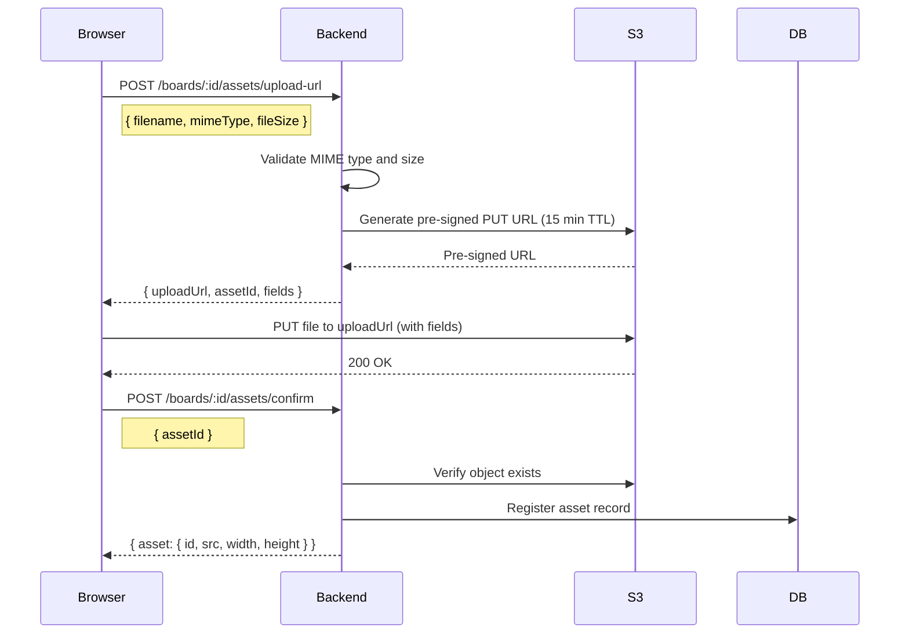

# Storage and Assets

**Status:** Proposed  
**Last Updated:** 2024-01-15

---

## Overview

Codrawithm stores uploaded images and other user assets in an S3-compatible object storage service. The default self-hosted option is **MinIO**. Cloud deployments can use AWS S3, GCP GCS, or Azure Blob Storage (all support the S3 API).

---

## Upload Flow

The browser never uploads directly to the backend. Instead, a pre-signed URL pattern is used:



---

## Validation Rules

The backend validates before issuing a pre-signed URL:

| Rule | Value |
|------|-------|
| Maximum file size | 20 MB |
| Allowed MIME types | `image/png`, `image/jpeg`, `image/gif`, `image/webp`, `image/svg+xml` |
| Filename sanitization | Alphanumeric + `-.` only; max 255 characters |

If validation fails, the backend returns 422 with a descriptive error. No URL is issued.

---

## Storage Layout

Assets are stored under a structured key prefix:

```
/{env}/{boardId}/{assetId}.{ext}
```

Example:
```
/prod/a1b2c3d4-e5f6-7890-abcd-ef1234567890/img_A3bX9k.png
```

**Thumbnails** (auto-generated on board save):
```
/prod/thumbnails/{boardId}.png
```

**PDF exports** (temporary, 24-hour TTL):
```
/prod/exports/{boardId}/{exportId}.pdf
```

---

## Bucket Configuration

**Bucket:** `codrawithm-assets` (configurable via `STORAGE_BUCKET_NAME` env var).

**Recommended bucket policy:**
- Objects are private by default.
- Access is controlled by pre-signed URLs (read) or IAM policy (backend write).
- Lifecycle rules: delete objects not referenced by any asset record after 30 days (future enhancement).

**CORS configuration** (for direct browser upload via pre-signed URL):
```json
[{
  "AllowedOrigins": ["https://app.codrawithm.app"],
  "AllowedMethods": ["PUT", "GET"],
  "AllowedHeaders": ["Content-Type", "Content-Length"],
  "MaxAgeSeconds": 3000
}]
```

---

## Asset Serving

Assets are served via pre-signed GET URLs with a 1-hour expiry. The frontend requests a fresh URL from the backend if the existing URL has expired.

For public boards, a longer-lived URL (24 hours) is generated.

**Future enhancement:** Serve assets via CDN for improved latency. The CDN would be fronted on the S3 bucket, and pre-signed URLs would reference the CDN domain.

---

## Size Limits by Tier

| Tier | Storage Quota | Notes |
|------|--------------|-------|
| Free | 1 GB | Per user (across all boards) |
| Pro | 20 GB | Per user |
| Self-hosted | Configurable | Operator sets `STORAGE_QUOTA_GB` env var |

Storage usage is tracked in the `assets` table by summing `file_size` per user.

---

## Board Thumbnail Generation

Board thumbnails are generated server-side using the canvas renderer (headless). The thumbnail is a 400 × 300 px PNG.

Thumbnail generation is triggered:
- On board save (debounced — at most once per 60 seconds).
- On explicit request (`POST /boards/:id/thumbnail/generate`).

**Implementation:** The backend spawns a headless Chromium process (via `puppeteer-core` or a Rust equivalent) to render the board JSON as a canvas and capture a screenshot. This is a background job and does not block the API response.

---

## Related Documents

- [Database Design — assets table](database-design.md#assets)
- [API Design — Asset Endpoints](api-design.md#asset-endpoints)
- [Operations — Backups & Recovery](../operations/backups-and-recovery.md)
- [ADR-010: Database and Storage](architecture-decisions/ADR-010-database-and-storage.md)
