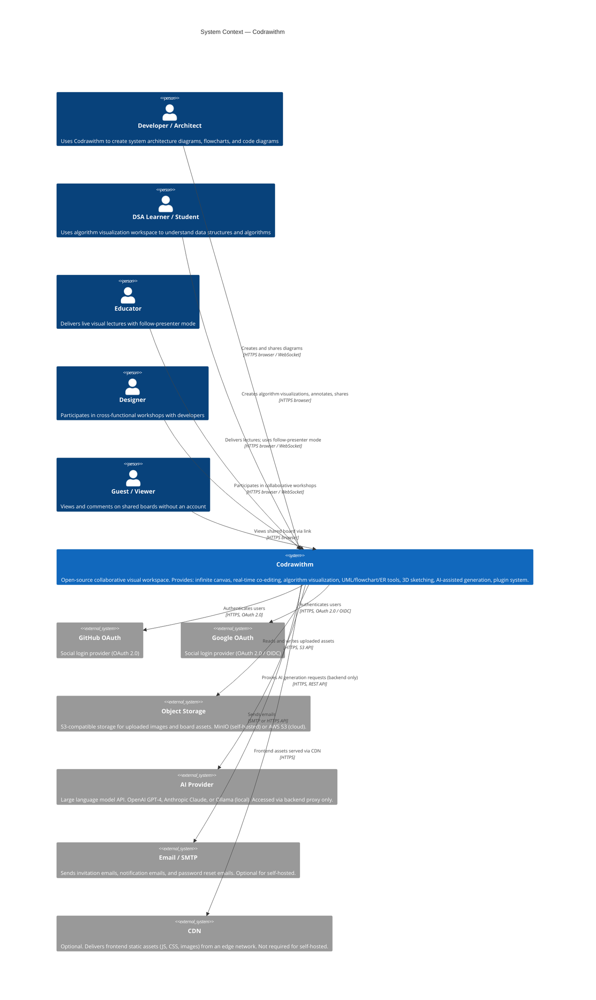

# System Context (C4 Level 1)

**Status:** Proposed  
**Last Updated:** 2024-01-15

---

## Overview

The C4 Level 1 diagram shows Codrawithm in the context of its users and external systems. It does not show internal structure.

---

## System Context Diagram



---

## Key Boundary: Browser vs. Backend

A critical security boundary in the system context is that **AI provider communication only occurs from the backend, never from the browser**. This prevents API keys from being exposed in browser developer tools or network requests.

```
Browser (User) ──────────────► Codrawithm Backend ──────────────► AI Provider API
                (WebSocket/REST)                    (HTTPS, backend only)
```

---

## External Dependencies and Self-Hosting Alternatives

| External System | Cloud Option | Self-Hosted Alternative | Required? |
|----------------|-------------|------------------------|-----------|
| Object Storage | AWS S3, GCP GCS, Azure Blob | MinIO | Yes (for image uploads) |
| OAuth Provider | GitHub, Google | None — email/password auth is always available | No (email auth works without OAuth) |
| AI Provider | OpenAI, Anthropic | Ollama (local LLM) | No (AI features are optional plugins) |
| Email | SendGrid, AWS SES, Postmark | Any SMTP server (Gmail, local Postfix) | No (invites and notifications disabled if not configured) |
| CDN | CloudFront, Cloudflare | None — backend serves static assets directly | No |

**Full offline operation:** For air-gapped environments, Codrawithm can operate with MinIO for object storage, no OAuth (email/password only), Ollama for AI, and a local SMTP server. No internet connectivity is required.

---

## User Count Assumptions

| User Type | Expected Concurrent | Notes |
|-----------|--------------------|-|
| Registered users (total) | 0 (Phase 1) | Pre-development |
| Concurrent board editors (per board) | 50 (target) | See NFR-010 |
| Concurrent boards | 100 (Phase 1) | Scales with backend instances |
| Guest viewers per board | 500 (Phase 2) | Follow-presenter mode: read-only WebSocket fan-out |

---

## Related Documents

- [Architecture Overview](overview.md)
- [Application Architecture (C4 Level 2)](application-architecture.md)
- [Deployment Architecture](deployment-architecture.md)
