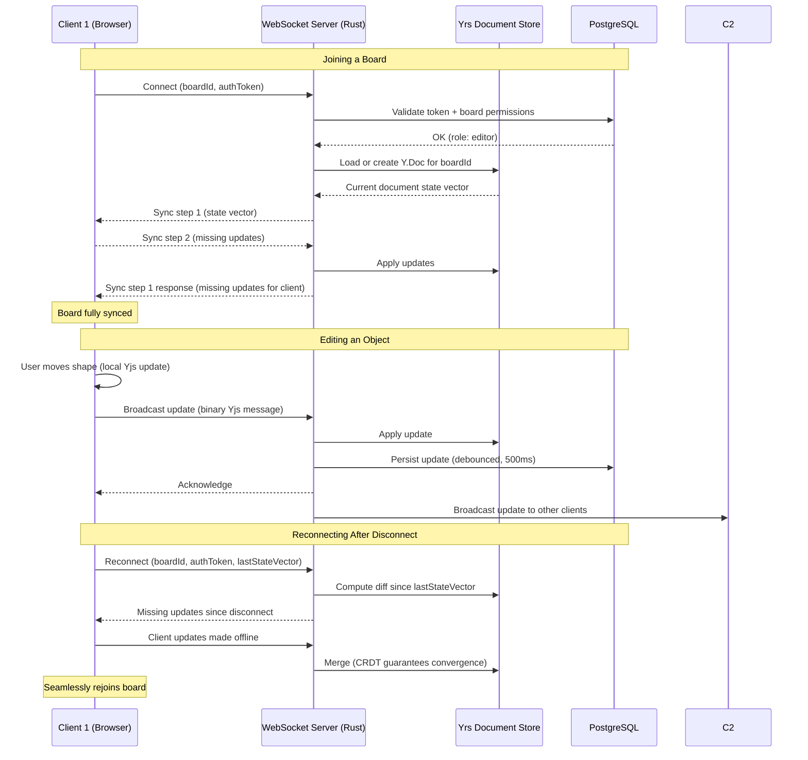

# Sync Protocol

**Status:** Proposed  
**Audience:** Backend engineers, collaboration engineers  
**Last Reviewed:** 2024-01-15

## Overview

Codrawithm's real-time collaboration is built on [Yjs](https://github.com/yjs/yjs) (MIT license), a high-performance CRDT (Conflict-free Replicated Data Type) framework. Yjs enables multiple users to edit the same board simultaneously without conflicts, even across unreliable network connections.

---

## Why Yjs

| Criterion | Yjs | Operational Transform | Custom CRDT |
|-----------|-----|-----------------------|-------------|
| License | MIT | N/A | N/A |
| Maturity | Production-proven (Notion, Liveblocks use CRDT) | Complex, error-prone | Very high effort |
| Offline support | Built-in | Complex to add | Custom |
| Undo/redo | Built-in (UndoManager) | Complex | Custom |
| Binary encoding | Yes (compact) | Varies | Custom |
| Rust port | `yrs` crate available | No | N/A |

Yjs is the recommended choice. See [ADR-008](../architecture/architecture-decisions/ADR-008-real-time-collaboration.md).

---

## Architecture



---

## Yjs Document Structure

Each board maps to one `Y.Doc`. The document is structured as a set of shared types:

```typescript
// Top-level Y.Doc structure for a board
const doc = new Y.Doc()

// Objects map: objectId -> Y.Map of object properties
const objects = doc.getMap<Y.Map<unknown>>('objects')

// Pages array: ordered list of page IDs
const pages = doc.getArray<string>('pages')

// Page metadata map: pageId -> Y.Map
const pageMeta = doc.getMap<Y.Map<unknown>>('pageMeta')

// Object-to-page membership
const pageObjects = doc.getMap<Y.Array<string>>('pageObjects')

// Board metadata
const meta = doc.getMap<unknown>('meta')

// Awareness (presence) - NOT persisted, ephemeral only
// Handled via y-protocols/awareness, separate from doc state
```

### Object Representation in Yjs

Each canvas object is a `Y.Map` with observable properties:

```typescript
const shapeMap = new Y.Map()
shapeMap.set('id', 'obj_01HN...')
shapeMap.set('type', 'shape')
shapeMap.set('subtype', 'rectangle')
shapeMap.set('x', 100)
shapeMap.set('y', 200)
shapeMap.set('width', 120)
shapeMap.set('height', 60)
shapeMap.set('style', new Y.Map()) // nested map for style properties
shapeMap.set('label', 'Node A')
shapeMap.set('zIndex', 5)
shapeMap.set('locked', false)

objects.set('obj_01HN...', shapeMap)
```

Text content uses `Y.Text` for collaborative text editing with character-level merging:

```typescript
const textMap = new Y.Map()
textMap.set('content', new Y.Text('Hello world')) // collaborative text
textMap.set('x', 300)
// ...
```

---

## Transport Layer

### WebSocket Protocol

The server exposes a WebSocket endpoint at `/ws/board/:boardId`.

**Connection handshake:**
1. Client connects with `Authorization: Bearer <token>` header
2. Server validates token and board access
3. Server sends current awareness state (other users' presence)
4. Yjs sync protocol (steps 1 and 2) completes the initial load

**Message types (binary):**

| Type | Direction | Description |
|------|-----------|-------------|
| `sync` (1) | Both | Yjs sync protocol messages |
| `update` (2) | Both | Incremental document updates |
| `awareness` (3) | Both | Presence/cursor data (ephemeral) |
| `auth` (4) | Server→Client | Auth error / permission change |

Messages use Yjs's built-in binary encoding (`Y.encodeStateAsUpdate`, `Y.applyUpdate`).

### Rust Backend (yrs crate)

The Yrs crate ([https://github.com/y-crdt/y-crdt](https://github.com/y-crdt/y-crdt), MIT license) is the Rust port of Yjs. It provides the same CRDT semantics and binary encoding compatibility.

```rust
use yrs::{Doc, Transact, Map};

let doc = Doc::new();
{
    let mut txn = doc.transact_mut();
    let objects = txn.get_or_insert_map("objects");
    // apply updates from client
}
```

---

## Persistence Strategy

### Ephemeral vs Durable State

| Data | Storage | TTL |
|------|---------|-----|
| Yjs document updates | In-memory (yrs) + PostgreSQL | Permanent |
| Awareness / cursors | In-memory only | Session duration |
| Presence metadata | In-memory only | Session duration |
| Version snapshots | PostgreSQL | Configurable (e.g. 90 days) |

### Write Strategy

Updates are **not** written to the database on every message. Instead:

1. Every update is applied to the in-memory Yrs document immediately
2. Updates are batched and written to PostgreSQL every **500ms** (debounced)
3. A full document snapshot is written every **5 minutes** or on board close
4. Snapshots enable fast load without replaying the entire update log

### Database Schema (simplified)

```sql
-- Stores the current full document state
CREATE TABLE board_documents (
    board_id    UUID PRIMARY KEY REFERENCES boards(id),
    ydoc_state  BYTEA NOT NULL,       -- Encoded Yjs state
    updated_at  TIMESTAMPTZ NOT NULL DEFAULT now()
);

-- Stores incremental updates for history/recovery
CREATE TABLE board_updates (
    id          BIGSERIAL PRIMARY KEY,
    board_id    UUID NOT NULL REFERENCES boards(id),
    update_data BYTEA NOT NULL,        -- Encoded Yjs update
    client_id   UUID,
    created_at  TIMESTAMPTZ NOT NULL DEFAULT now()
);

CREATE INDEX idx_board_updates_board_created 
    ON board_updates(board_id, created_at DESC);
```

---

## Conflict Resolution

Yjs CRDTs are designed so that conflicts never occur in the traditional sense — concurrent edits always merge deterministically. The rules:

- **Concurrent text edits:** Character insertions are interleaved by client ID ordering
- **Concurrent property changes:** Last-writer-wins per property (each `Y.Map` key is independent)
- **Concurrent deletions:** Deletion always wins over concurrent modification
- **Concurrent object creation:** Both objects are preserved (unique IDs prevent conflicts)

See [conflict-resolution.md](./conflict-resolution.md) for detailed scenarios.

---

## Rate Limits and Abuse Prevention

| Limit | Value | Enforcement |
|-------|-------|-------------|
| Max update size | 512 KB per message | Server-side validation |
| Max messages/second per client | 50 | Token bucket, server-side |
| Max concurrent connections per board | 50 | Room capacity limit |
| Max board document size | 50 MB (uncompressed) | Checked on write |
| Awareness update frequency | Max 10/second per client | Client-side throttle |

---

## Related Documents

- [Conflict Resolution](./conflict-resolution.md)
- [Presence and Cursors](./presence-and-cursors.md)
- [Offline Mode](./offline-mode.md)
- [Permissions](./permissions.md)
- [Collaboration Engine Architecture](../architecture/collaboration-engine.md)
- [ADR-008: Real-Time Collaboration](../architecture/architecture-decisions/ADR-008-real-time-collaboration.md)
