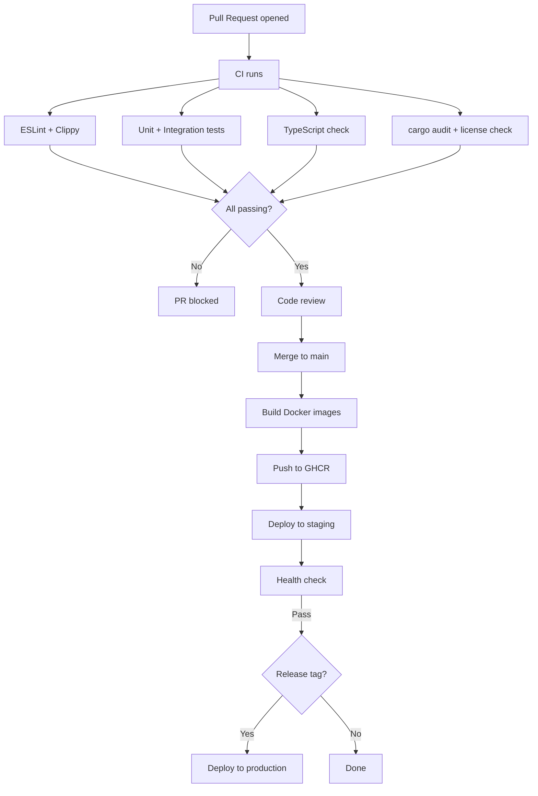

# Release Process

**Status:** Proposed  
**Audience:** Maintainers, engineers  
**Last Reviewed:** 2024-01-15

## Versioning

Codrawithm follows [Semantic Versioning 2.0.0](https://semver.org/):

- **MAJOR** (1.x.x → 2.x.x): Breaking changes to public APIs or saved board format
- **MINOR** (0.1.x → 0.2.x): New features, backward-compatible
- **PATCH** (0.1.0 → 0.1.1): Bug fixes, backward-compatible

During pre-1.0 development, minor versions may include breaking changes with clear documentation.

---

## Branch Strategy

```
main                — always deployable, protected branch
  ↑
feat/*, fix/*       — feature and fix branches (short-lived)
  ↑
hotfix/*            — emergency fixes for production
```

- All changes go through pull requests — no direct commits to `main`
- Feature branches are deleted after merge
- Release tags are created on `main`

---

## CI/CD Pipeline



### CI Jobs (GitHub Actions)

```yaml
# .github/workflows/ci.yml (planned)
name: CI

on:
  pull_request:
    branches: [main]
  push:
    branches: [main]

jobs:
  frontend:
    runs-on: ubuntu-latest
    steps:
      - uses: actions/checkout@v4
      - uses: pnpm/action-setup@v3
      - run: pnpm install --frozen-lockfile
      - run: pnpm typecheck
      - run: pnpm lint
      - run: pnpm test --run
      - run: pnpm build

  backend:
    runs-on: ubuntu-latest
    steps:
      - uses: actions/checkout@v4
      - uses: dtolnay/rust-toolchain@stable
        with:
          components: clippy, rustfmt
      - run: cargo fmt --check
      - run: cargo clippy -- -D warnings
      - run: cargo test
      - run: cargo audit
```

---

## Release Checklist

Before creating a release tag:

- [ ] All CI checks pass on `main`
- [ ] CHANGELOG.md updated with this release's changes
- [ ] Version bumped in `Cargo.toml` and `package.json`
- [ ] Any breaking changes documented in the changelog
- [ ] Tested on staging environment
- [ ] Database migrations are backward-compatible with the previous version (or migration is coordinated)

---

## Creating a Release

```bash
# 1. Update version
# Edit Cargo.toml, apps/web/package.json

# 2. Update CHANGELOG.md
# Add entry for the new version with date and changes

# 3. Commit version bump
git add Cargo.toml apps/web/package.json CHANGELOG.md
git commit -m "chore: release v0.2.0"

# 4. Tag the release
git tag -a v0.2.0 -m "Release v0.2.0"
git push origin main --tags

# 5. GitHub Actions builds and deploys automatically
# 6. Create a GitHub Release from the tag with changelog notes
```

---

## Changelog Format

```markdown
# Changelog

## [0.2.0] — 2024-03-15

### Added
- BFS step-by-step visualization in Algorithm Lab
- Mind map workspace type
- 10 new board templates

### Changed
- Improved canvas performance with 1,000+ objects
- Redesigned properties panel

### Fixed
- Connector routing now handles overlapping objects correctly
- Export SVG no longer clips text labels

### Breaking Changes
- Board JSON format version bumped to 1.1 — old boards migrate automatically on open
```

---

## Hotfix Process

For urgent production bugs:

```bash
# Create hotfix branch from the release tag
git checkout -b hotfix/fix-critical-auth-bug v0.2.0

# Fix the bug, add test
git commit -m "fix(auth): prevent token reuse after logout"

# PR to main (fast review — security issue)
# After merge, tag a patch release
git tag -a v0.2.1 -m "Hotfix: v0.2.1"
```

---

## Related Documents

- [Deployment](../operations/deployment.md)
- [Dependency Management](./dependency-management.md)
- [Coding Standards](./coding-standards.md)
