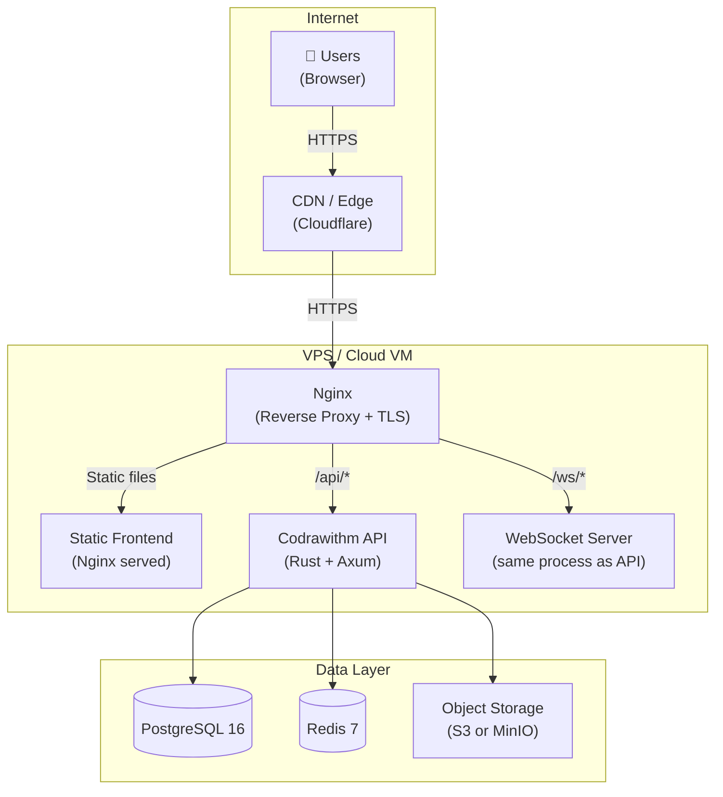

# Deployment

**Status:** Proposed  
**Audience:** Engineers, DevOps  
**Last Reviewed:** 2024-01-15

## Overview

Codrawithm's deployment strategy starts simple — a single server with Docker Compose — and can scale horizontally as needed. The goal is to avoid premature infrastructure complexity while keeping the path to scaling clear.

---

## Deployment Topology



---

## Phase 1: Single VPS (MVP)

A single VPS (e.g. Hetzner CX21, DigitalOcean Droplet, or similar) running everything via Docker Compose.

**Minimum recommended specs:**
- 2 vCPU, 4GB RAM, 40GB SSD
- Ubuntu 22.04 LTS

### Docker Compose (Production)

```yaml
# docker-compose.prod.yml
version: '3.9'

services:
  nginx:
    image: nginx:alpine
    ports:
      - "80:80"
      - "443:443"
    volumes:
      - ./nginx.conf:/etc/nginx/nginx.conf:ro
      - ./ssl:/etc/nginx/ssl:ro
      - frontend_build:/usr/share/nginx/html:ro
    depends_on:
      - api

  api:
    image: ghcr.io/kanishjebamathewm/codrawithm-api:latest
    environment:
      DATABASE_URL: ${DATABASE_URL}
      REDIS_URL: ${REDIS_URL}
      JWT_SECRET: ${JWT_SECRET}
      STORAGE_PROVIDER: s3
      S3_BUCKET: ${S3_BUCKET}
    depends_on:
      - postgres
      - redis
    restart: unless-stopped

  postgres:
    image: postgres:16-alpine
    volumes:
      - postgres_data:/var/lib/postgresql/data
    environment:
      POSTGRES_DB: ${POSTGRES_DB}
      POSTGRES_USER: ${POSTGRES_USER}
      POSTGRES_PASSWORD: ${POSTGRES_PASSWORD}
    restart: unless-stopped

  redis:
    image: redis:7-alpine
    volumes:
      - redis_data:/data
    command: redis-server --appendonly yes
    restart: unless-stopped

volumes:
  postgres_data:
  redis_data:
  frontend_build:
```

### Frontend Build

The React frontend is built to static files and served by Nginx:

```dockerfile
# apps/web/Dockerfile
FROM node:20-alpine AS builder
WORKDIR /app
COPY package.json pnpm-lock.yaml ./
RUN npm install -g pnpm && pnpm install --frozen-lockfile
COPY . .
RUN pnpm build

FROM nginx:alpine
COPY --from=builder /app/dist /usr/share/nginx/html
COPY nginx.conf /etc/nginx/conf.d/default.conf
```

### Backend Build

```dockerfile
# apps/api/Dockerfile
FROM rust:1.75-alpine AS builder
RUN apk add --no-cache musl-dev
WORKDIR /app
COPY . .
RUN cargo build --release

FROM alpine:latest
RUN apk add --no-cache libgcc
COPY --from=builder /app/target/release/codrawithm-api /usr/local/bin/
CMD ["codrawithm-api"]
```

---

## Deployment Process

```bash
# On the VPS

# 1. Pull latest images
docker compose -f docker-compose.prod.yml pull

# 2. Run migrations before updating the app
docker compose -f docker-compose.prod.yml run --rm api sqlx migrate run

# 3. Deploy with zero-downtime restart
docker compose -f docker-compose.prod.yml up -d --no-deps --build api

# 4. Verify health
curl https://api.codrawithm.dev/health
```

---

## TLS / SSL

Use Certbot (Let's Encrypt) for free TLS certificates:

```bash
# Install certbot
apt install certbot python3-certbot-nginx

# Obtain certificate
certbot --nginx -d codrawithm.dev -d www.codrawithm.dev -d api.codrawithm.dev

# Auto-renewal is set up automatically by certbot
```

---

## Health Checks

The API exposes health check endpoints:

| Endpoint | Purpose |
|----------|---------|
| `GET /health` | Basic liveness check — returns 200 if server is running |
| `GET /health/ready` | Readiness check — verifies DB and Redis connectivity |

Nginx upstream health checks and Docker restart policies handle automatic recovery.

---

## CI/CD Pipeline

See [release-process.md](../engineering/release-process.md) for the full CI/CD workflow.

Summary:
1. Push to `main` triggers GitHub Actions
2. Run tests + lint
3. Build Docker images
4. Push to GitHub Container Registry (`ghcr.io`)
5. SSH to VPS and run deployment script
6. Health check confirms successful deployment

---

## Scaling Path (Future)

When the single VPS is insufficient:

1. **Database:** Move PostgreSQL to a managed service (Supabase, RDS, Neon)
2. **Redis:** Move to managed Redis (Upstash, ElastiCache)
3. **API:** Deploy multiple API replicas behind a load balancer
4. **WebSockets:** Use Redis pub/sub to fan out WebSocket messages across API instances
5. **Frontend:** Host static files on a CDN (Cloudflare Pages, Vercel)
6. **Storage:** Already on S3-compatible — no change needed

---

## Related Documents

- [Local Development](./local-development.md)
- [Environment Configuration](./environment-configuration.md)
- [Database Migrations](./database-migrations.md)
- [Backups and Recovery](./backups-and-recovery.md)
- [Deployment Architecture](../architecture/deployment-architecture.md)
