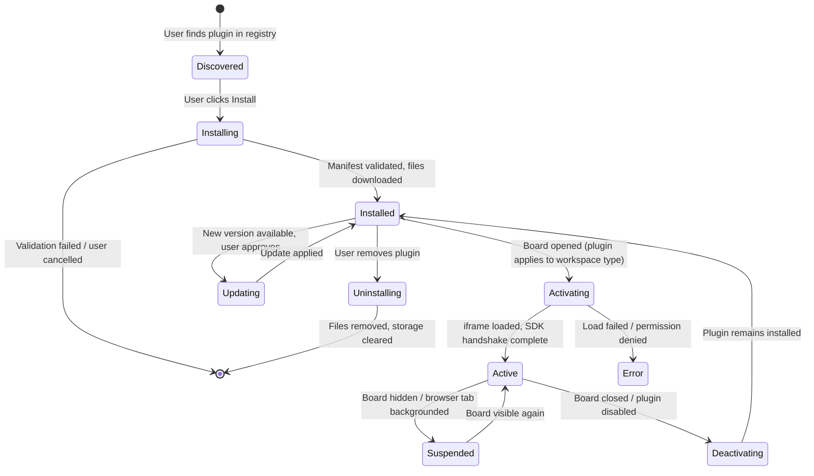

# Plugin Lifecycle

**Status:** Proposed  
**Audience:** Plugin developers, platform engineers  
**Last Reviewed:** 2024-01-15

## Overview

This document describes the full lifecycle of a Codrawithm plugin from discovery through removal, including installation, activation, configuration, update, and uninstallation.

---

## Lifecycle Diagram



---

## Phase 1: Discovery and Installation

### Plugin Registry

Plugins are discovered through:
1. The in-app Plugin Registry (curated list)
2. Manual installation from a URL (for development / unlisted plugins)
3. Workspace-level shared plugins (admin installs for all workspace members)

### Installation Steps

1. User clicks "Install" on a plugin listing
2. Platform downloads `manifest.json` and validates it
3. Platform shows permission summary to the user
4. User confirms installation
5. Platform downloads plugin assets (UI HTML, worker JS, icons)
6. Plugin is stored in platform's plugin store (associated with user account)
7. Plugin appears in user's installed plugins list

### Installation Validation

Before storing the plugin, the platform checks:
- Manifest JSON schema validity
- All declared permissions are recognized
- `minPlatformVersion` compatibility
- Plugin ID doesn't conflict with an existing installed plugin
- Asset files are present and within size limits (50MB total per plugin)

---

## Phase 2: Activation

A plugin is activated when a board is opened and the plugin applies to that workspace type.

### Activation Steps

1. Platform creates a sandboxed `<iframe>` for the plugin UI
2. iframe is given `sandbox="allow-scripts allow-forms"` (no same-origin, no navigation)
3. Plugin UI HTML is loaded into the iframe
4. Platform sends an `init` message with context:
   ```json
   {
     "type": "init",
     "pluginId": "com.example.text-to-flowchart",
     "boardId": "board_01HN...",
     "userId": "user_01HN...",
     "userRole": "editor",
     "permissions": ["canvas:read", "canvas:write", "ai:request"],
     "config": { "defaultProvider": "openai" }
   }
   ```
5. Plugin responds with `ready` message
6. Plugin is now active and can make API calls

### Activation Timeout

If the plugin doesn't respond with `ready` within 10 seconds, it is marked as failed and the user is notified.

---

## Phase 3: Active State

While active, the plugin:
- Receives event callbacks it subscribed to (selection changes, object events)
- Can make API calls via the SDK
- Renders UI in its panel or modal
- May have a Web Worker running for background computation

### Suspension

When the browser tab is hidden or the board is minimized:
- Plugin receives a `suspend` event
- Should pause expensive operations
- Web Worker may be throttled by the browser

When the board becomes visible again:
- Plugin receives a `resume` event
- Should resume normal operation

---

## Phase 4: Configuration

Users can configure plugins via Settings → Plugins → [Plugin Name].

Configuration schema is defined in the manifest's `configuration.properties` field. The platform renders a settings UI automatically based on the schema:

| Property Type | UI Control |
|--------------|------------|
| `string` (no enum) | Text input |
| `string` (with enum) | Select dropdown |
| `boolean` | Toggle switch |
| `number` | Number input |
| `integer` (with min/max) | Slider |

Configuration changes take effect immediately (plugin receives a `configChanged` event).

---

## Phase 5: Updates

When a new plugin version is available:
1. User sees an "Update available" badge in the plugin list
2. Platform shows changelog if provided
3. Platform shows new/removed permissions if any changed
4. User confirms update
5. Platform downloads and replaces plugin assets
6. Plugin is deactivated and reactivated with the new version

**Automatic updates:** Not enabled by default. Users must approve each update. (Workspace admins can enable auto-updates for workspace plugins.)

---

## Phase 6: Deactivation

When a board is closed:
1. Platform sends `deactivate` event to the plugin
2. Plugin has 3 seconds to save state and clean up
3. iframe is removed from DOM
4. Web Worker is terminated
5. All event subscriptions are automatically cleaned up

---

## Phase 7: Uninstallation

1. User navigates to Settings → Plugins → [Plugin Name] → Uninstall
2. Platform asks for confirmation: "Uninstall [Plugin Name]? This will remove all plugin data."
3. On confirmation:
   - Plugin assets are removed
   - Plugin storage (`storage:plugin`) is cleared
   - Plugin is removed from all boards (deactivated)
   - Plugin entry removed from user's account

**Note:** `storage:board` data (stored on the board, not the plugin) may be retained to preserve board content that the plugin created.

---

## Plugin Entry Points

### UI Entry Point (`entryPoints.ui`)

An HTML file loaded in the sandboxed iframe. Must include the plugin SDK:

```html
<!DOCTYPE html>
<html>
<head>
  <meta charset="utf-8">
  <meta http-equiv="Content-Security-Policy" 
        content="default-src 'none'; script-src 'self'; style-src 'self' 'unsafe-inline'">
</head>
<body>
  <div id="app"></div>
  <script src="./bundle.js"></script>
</body>
</html>
```

### Worker Entry Point (`entryPoints.worker`)

An optional Web Worker for background processing (e.g. heavy computation, AI response parsing):

```javascript
// worker.js
self.onmessage = (event) => {
  const { type, data } = event.data
  if (type === 'process') {
    const result = heavyComputation(data)
    self.postMessage({ type: 'result', data: result })
  }
}
```

---

## Related Documents

- [Plugin Manifest](./plugin-manifest.md)
- [Plugin API](./plugin-api.md)
- [Plugin Permissions](./plugin-permissions.md)
- [Plugin Security](./plugin-security.md)
