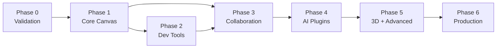

# Product Roadmap

**Status:** Proposed  
**Audience:** All contributors, community  
**Last Reviewed:** 2024-01-15

> This roadmap describes planned work, not completed features. Phases are sequential but their scope may shift based on community feedback and technical discoveries. Exit criteria must be met before moving to the next phase.

---

## Phase 0 — Requirements and Technical Validation
**Goal:** Establish a solid foundation before writing production code.

### Deliverables
- [ ] Finalize product requirements and MVP scope (this documentation)
- [ ] Complete ADR decisions with community discussion
- [ ] Evaluate and prototype canvas rendering approaches (Konva.js vs custom)
- [ ] Benchmark Canvas 2D rendering with 500 and 5,000 objects
- [ ] Prototype Yjs collaboration sync (proof-of-concept board)
- [ ] Verify all library licenses (Konva, Yjs, Three.js, shadcn/ui, Lucide)
- [ ] Select and document the open-source license for the project
- [ ] Set up repository structure, CI, and contributor tooling
- [ ] Publish good-first-issues for community onboarding

### Exit Criteria
- Architecture decisions documented and reviewed
- Canvas rendering PoC achieves ≥ 55fps with 500 objects on mid-range hardware
- License confirmed and added to repository
- At least one external contributor has engaged in GitHub Discussions

### Dependencies
None — this is the starting phase.

### Risks
- Canvas library license incompatibility discovered late → forces re-evaluation
- Community doesn't engage → product direction lacks external validation

---

## Phase 1 — Core 2D Canvas Workspace
**Goal:** Ship a genuinely useful single-user drawing application.

### Deliverables
- [ ] Application shell (React + TypeScript, Vite, Tailwind, shadcn/ui)
- [ ] Scene/document model with serialization
- [ ] Canvas engine (Konva.js integration, viewport, pan/zoom)
- [ ] Drawing tools: pen, shapes, text, arrows, connectors, sticky notes
- [ ] Selection, move, resize, rotate, delete, duplicate
- [ ] Undo/redo (100-step history)
- [ ] Autosave to localStorage
- [ ] Export: PNG, SVG, JSON board format
- [ ] Import: JSON board format
- [ ] Design system (tokens, components)
- [ ] Keyboard shortcuts (core set)
- [ ] Basic templates (blank, flowchart, mind map)
- [ ] Rust+Axum backend scaffold (health check, basic API structure)
- [ ] PostgreSQL schema and migrations (users, boards, basic auth)
- [ ] Unit and integration test suite established
- [ ] CI/CD pipeline (GitHub Actions)

### Exit Criteria
- A user can open the app, draw a diagram with shapes and connectors, save it, close the browser, and reopen it
- Canvas renders 500 objects at ≥ 55fps
- Core keyboard shortcuts work
- All Phase 1 features have passing tests
- Passes Lighthouse accessibility score ≥ 80

### Dependencies
- Phase 0 complete: ADRs decided, canvas PoC validated

### Risks
- Scope creep (adding features before core is solid)
- Canvas performance issues with complex diagrams
- State management complexity grows faster than expected

---

## Phase 2 — Developer Tools and Workspace Types
**Goal:** Make Codrawithm distinctly useful for developers and learners.

### Deliverables
- [ ] Workspace type selector and specialist tool palettes
- [ ] Algorithm Lab workspace: graph nodes, edges, directed/weighted
- [ ] DSA visualization: arrays, linked lists, trees, basic graphs
- [ ] Step-by-step playback engine (play/pause/step/reset/speed)
- [ ] BFS, DFS, binary search visualizations
- [ ] Sorting algorithm visualizations (bubble, merge, quick)
- [ ] Code snippet panel (syntax highlighting, read-only initially)
- [ ] System architecture diagram shapes (services, databases, queues)
- [ ] Flowchart workspace with auto-routing connectors
- [ ] Mind map workspace with tree layout
- [ ] Reusable templates library (10+ templates)
- [ ] Multiple pages per board
- [ ] Frames/sections for presentation

### Exit Criteria
- A DSA learner can build a binary tree, run BFS step-by-step, and see state update correctly
- All algorithm visualizations are deterministic and pass automated playback tests
- Developer templates are usable in < 2 minutes from board creation

### Dependencies
- Phase 1 complete: core canvas and scene model

### Risks
- Algorithm visualization engine complexity (separation of execution model from renderer)
- Template quality — needs user testing with real learners

---

## Phase 3 — Real-Time Collaboration
**Goal:** Multiple users can edit the same board simultaneously.

### Deliverables
- [ ] User accounts (registration, login, JWT auth)
- [ ] Board ownership and membership
- [ ] Yjs integration (board state as Y.Doc)
- [ ] WebSocket server (Rust, yrs crate)
- [ ] Shared cursors and presence indicators
- [ ] Real-time object sync (create, update, delete, move)
- [ ] Collaborative undo/redo (per-user UndoManager)
- [ ] Board share links (viewer, commenter, editor)
- [ ] Permissions system (owner, editor, commenter, viewer)
- [ ] Reconnection with state recovery
- [ ] Offline editing with sync-on-reconnect
- [ ] Comments and annotations
- [ ] Board dashboard and workspace management
- [ ] Version history (snapshots + restore)

### Exit Criteria
- Two users on different machines can edit the same board without data loss
- Concurrent edits converge to the same state
- Reconnection after 60s network gap recovers all offline edits
- Collaboration latency < 200ms on LAN, < 500ms on typical internet

### Dependencies
- Phase 1 complete: scene model
- Phase 2 helps validate the data model under complex use cases

### Risks
- Yjs + Rust yrs crate integration complexity
- WebSocket scaling for many concurrent boards
- Undo/redo in collaborative context is confusing to users

---

## Phase 4 — AI Plugins
**Goal:** Enable AI-assisted diagram generation through a secure plugin platform.

### Deliverables
- [ ] Plugin manifest format and validation
- [ ] Plugin sandbox (iframe isolation, postMessage API)
- [ ] Plugin SDK (`@codrawithm/plugin-sdk`)
- [ ] Plugin lifecycle management (install, activate, update, uninstall)
- [ ] AI proxy backend (OpenAI + Anthropic via secure server-side proxy)
- [ ] User AI quota system
- [ ] Text-to-flowchart reference plugin
- [ ] Text-to-mind-map plugin
- [ ] Plugin permission prompts
- [ ] Plugin marketplace UI (basic listing)
- [ ] Developer documentation for plugin authoring

### Exit Criteria
- A plugin can generate an editable flowchart from a text prompt
- AI credentials never appear in browser network requests
- Quota enforcement prevents runaway AI costs
- External developer can author and install a plugin following public docs

### Dependencies
- Phase 3 complete: auth, user accounts, board data model

### Risks
- AI inference cost at scale
- Plugin security — iframe sandbox needs thorough security review
- AI output quality varies — users frustrated by poor generations

---

## Phase 5 — Advanced Creative Capabilities
**Goal:** 3D workspace, simulations, and specialist tools.

### Deliverables
- [ ] 3D workspace (Three.js, lazy-loaded)
- [ ] 3D primitives, camera controls, scene hierarchy
- [ ] 3D file import (GLTF/GLB)
- [ ] 3D data structure visualization (3D graphs, trees)
- [ ] Simulation workspace (basic flow simulation)
- [ ] Event floor-plan workspace
- [ ] Data visualization canvas (charts, graphs)
- [ ] Advanced presentation mode (follow-presenter, full-screen)
- [ ] Teaching board templates

### Exit Criteria
- 3D workspace loads in < 3s and doesn't increase main bundle size for non-3D users
- Basic 3D scene with 1,000 objects renders at ≥ 30fps
- 3D module passes GPU context loss recovery test

### Dependencies
- Phase 4 complete: plugin platform (3D tools can be plugins)

### Risks
- Three.js bundle size — must be strictly lazy-loaded
- GPU resource management complexity
- 3D UX is hard — high design investment needed

---

## Phase 6 — Production Readiness
**Goal:** Hardened, observable, accessible, and commercially viable platform.

### Deliverables
- [ ] Full WCAG 2.1 AA accessibility audit and fixes
- [ ] Security audit (auth, permissions, plugin sandbox, file uploads)
- [ ] Performance budgets passing on P90 hardware
- [ ] Backup and recovery procedures tested
- [ ] Rate limiting and abuse prevention hardened
- [ ] Monitoring, alerting, and incident response operational
- [ ] Self-hosting documentation
- [ ] Pro subscription infrastructure (if validated by Phase 5 usage data)
- [ ] Stable public API with versioning policy
- [ ] Full contributor documentation and onboarding

### Exit Criteria
- WCAG 2.1 AA compliance verified by external audit
- Security review complete with no critical findings
- 99.5% uptime SLA achievable with current infrastructure
- Complete documentation for self-hosting

### Dependencies
- All prior phases

---

## Roadmap Dependency Graph

---

## Related Documents

- [Milestones](./milestones.md)
- [Technical Risks](./technical-risks.md)
- [Open Questions](./open-questions.md)
- [Research Spikes](./research-spikes.md)
